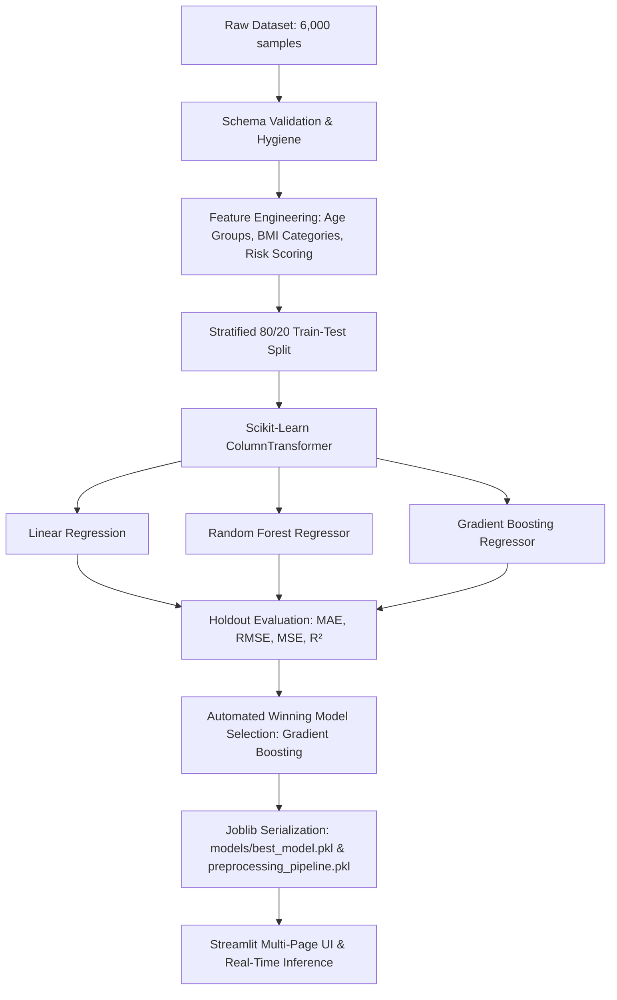

# Insurance Cost Predictor & Actuarial Risk Analytics

An enterprise-grade, multi-page machine learning and actuarial analytics web application built with **Python, Streamlit, Scikit-learn, and Plotly**. The application delivers real-time machine learning cost inference, heuristic risk indexing, what-if sensitivity simulations, and exploratory demographic analytics for healthcare insurance portfolio evaluation.

Deployed on **Streamlit Community Cloud**: [Live Application](https://github.com/wazer-123/ML-Project-Healthcare-Prediction)

---

## 📑 Table of Contents
1. [Project Overview](#-project-overview)
2. [Problem Statement & Objectives](#-problem-statement--objectives)
3. [Key Application Modules](#-key-application-modules)
4. [Technology Stack](#-technology-stack)
5. [Dataset Information](#-dataset-information)
6. [Machine Learning & MLOps Workflow](#-machine-learning--mlops-workflow)
7. [Model Benchmarking & Evaluation](#-model-benchmarking--evaluation)
8. [Project Architecture](#-project-architecture)
9. [Project Directory Structure](#-project-directory-structure)
10. [Local Installation & Setup](#-local-installation--setup)
11. [Running the Application](#-running-the-application)
12. [Automated Testing & Quality Assurance](#-automated-testing--quality-assurance)
13. [Streamlit Community Cloud Deployment](#-streamlit-community-cloud-deployment)
14. [Risk Logic & Non-Causal Ethical Disclaimers](#-risk-logic--non-causal-ethical-disclaimers)
15. [Limitations & Future Enhancements](#-limitations--future-enhancements)

---

## 🔍 Project Overview

The **Insurance Cost Predictor** bridges predictive machine learning and actuarial health economics. Instead of isolated single-page prediction forms, this platform provides an integrated suite for portfolio analysts, data scientists, and underwriters:
- **Executive Overview Dashboard:** Macro-level KPI cards, demographic distributions, and multi-dimensional filtering.
- **Real-Time ML Inference:** Predictive cost estimation with prorated monthly figures and heuristic risk indexing.
- **Actuarial Risk Profiling:** Calibrated Plotly Gauge visualizers with documented tier threshold logic.
- **Demographic & Cost Analytics:** Deep multi-tab exploratory analyses distinguishing correlation from causality.
- **Multi-Model MLOps Benchmarking:** Direct empirical comparison of Linear Regression, Random Forest, and Gradient Boosting algorithms on a 20% holdout test partition.
- **What-If Scenario Simulation:** Multi-cohort comparative matrices and real-time sensitivity sliders isolating marginal cost drivers.
- **Data Governance & Query Explorer:** Schema auditing, completeness tracking, custom visual query builder, and CSV exports.

---

## 🎯 Problem Statement & Objectives

### Problem Statement
Healthcare insurance underwriting and premium estimation require balanced assessment of biological, demographic, and lifestyle risk proxies. Underwriters and risk analysts need interactive simulation tools to test marginal cost sensitivities, diagnose algorithmic behavior, and understand compound interactions (such as the combined risk of high BMI and smoking).

### Project Objectives
1. **Actuarial Prediction Accuracy:** Train and benchmark candidate regression algorithms to achieve high prediction fidelity ($R^2 > 0.99$ on holdout test data).
2. **Explainability & Governance:** Provide non-causal statistical associations and feature importances to avoid misleading causal assumptions.
3. **Interactive Simulation:** Empower analysts to create and compare multi-applicant scenarios in real-time.
4. **Data Transparency:** Offer complete data exploration, summary statistics, and CSV data export across all pages.
5. **Production Reliability:** Ensure full compatibility with Streamlit Community Cloud and maintain an automated test suite.

---

## 🚀 Key Application Modules

### 1. Executive Dashboard (`pages/dashboard.py`)
- **Executive KPI Cards:** Total customers, average cost, median cost (50th percentile benchmark), smoking prevalence, min/max costs, average age, and high-risk cohort share.
- **Interactive Visualizations:** Annual charges distribution with box-plot marginals, cost by age group, demographic distribution by gender, BMI category breakdown, smoking impact box plots, and regional variations.
- **Multi-Dimensional Filters:** Age slider, gender multi-select, BMI slider, smoking status, region, and dependent count with instantaneous reactive chart updates.
- **Filtered Export:** Download filtered portfolio subsets directly as CSV.

### 2. Insurance Cost Predictor (`pages/predictor.py`)
- Real-time inference powered by the winning serialized production model (`Gradient Boosting Regressor`).
- Outputs: Predicted Annual Cost, Prorated Monthly Cost, Actuarial Risk Score (0–100), and Risk Classification Tier (`LOW`, `MEDIUM`, `HIGH`).
- **Prediction Insights:** Granular breakdown of feature factors *associated with the model prediction* without claiming deterministic causal guarantees.
- Individual applicant record export as CSV.

### 3. Customer Risk Profile (`pages/risk_profile.py`)
- Categorical demographic classifications: Age category, BMI classification, smoking status, dependents, region, and projected premium.
- Calibrated Plotly Gauge Chart with colored threshold bands:
  - **LOW Risk (0.0 – 34.9):** Non-smokers with standard BMI and lower claim frequency profiles.
  - **MEDIUM Risk (35.0 – 69.9):** Elevated BMI or senior age brackets.
  - **HIGH Risk (70.0 – 100.0):** Smokers, clinical obesity (BMI ≥ 30), or compound risk interactions.
- Comprehensive explanation of heuristic scoring limitations.

### 4. Cost & Demographic Analytics (`pages/analytics.py`)
- Continuous factor correlation: Age vs Cost (trendline stratified by smoking) and BMI vs Cost (obesity threshold breakdown).
- Demographic analysis: Cost by gender, region, age group, and dependent counts.
- Risk segmentation: Distribution of insurance charges by risk category.
- Pearson correlation matrix heatmap for numeric variables (`age`, `bmi`, `children`, `charges`, `risk_score`).
- Missing-value audit and parametric summary statistics.

### 5. Model Performance & Diagnostics (`pages/model_performance.py`)
- Multi-model comparison table: MAE, MSE, RMSE, and $R^2$ across Linear Regression, Random Forest, and Gradient Boosting.
- Automated winning model selection based on highest test $R^2$ and lowest RMSE.
- Actual vs Predicted regression charts with 45-degree ideal line.
- Residual scatter plots ($y_{pred}$ vs $residuals$) and error distribution histograms.
- Global feature importance horizontal ranking.
- Protected retraining controls with administrative confirmation.

### 6. What-If Scenario Analysis (`pages/scenario_analysis.py`)
- **Multi-Cohort Comparison:** Compare Scenario A (Young Healthy), Scenario B (Mid-Age Overweight Smoker), Scenario C (Senior Obese Smoker), and Custom Scenario D.
- Calculates exact dollar difference ($\pm\$$) and percentage difference ($\pm\%$) from baseline.
- **Real-Time Baseline Sensitivity Simulator:** Live sliders for Age, BMI, Smoking, Children, Region, and Gender with real-time marginal deviation readouts.
- Export scenario matrix as CSV.

### 7. Data Explorer (`pages/data_explorer.py`)
- Portfolio metadata audit: Total records, feature count, missing value validation, and memory footprint.
- Schema inspection: Data types, null counts, unique values, and sample values.
- Searchable and filterable record inspection tab.
- Statistical descriptions for continuous and categorical attributes.
- **Interactive Visual Query Builder:** Select any X-axis, Y-axis, Color grouping, and Chart Type (Scatter, Box, Histogram, Bar, Violin) on the fly.
- Export full dataset as CSV.

---

## 🛠️ Technology Stack

| Layer | Technology | Version | Purpose |
| :--- | :--- | :--- | :--- |
| **Language** | Python | 3.13.1 | Core application and ML logic |
| **Web Framework** | Streamlit | 1.53.1 | Multi-page reactive web application |
| **Data Processing** | Pandas | 2.3.3 | DataFrame manipulation and aggregations |
| **Numeric Computing**| NumPy | 2.4.1 | Vectorized computations and mathematical arrays |
| **Machine Learning** | Scikit-Learn | 1.7.0 | Preprocessing pipeline, regression models, metrics |
| **Data Visualization**| Plotly | ≥ 5.18.0 | Interactive web-based charts, gauges, heatmaps |
| **Serialization** | Joblib | 1.5.1 | Model and pipeline persistence |
| **Testing** | Pytest | ≥ 8.0.0 | Unit, integration, and regression test suites |

---

## 📊 Dataset Information

- **Dataset Provenance:** **Synthetic Actuarial Demonstration Dataset** (6,000 policyholder records).
- **Design:** Explicitly designated as synthetic actuarial demo data; not presented as proprietary real-company records.
- **Features Included:**
  1. `age`: Chronological age in years (18 – 65)
  2. `sex`: Biological gender (`male`, `female`)
  3. `bmi`: Body Mass Index in $\text{kg}/\text{m}^2$ (15.0 – 53.0)
  4. `children`: Number of dependent children (0 – 5)
  5. `smoker`: Tobacco smoking status (`yes`, `no`)
  6. `region`: Residential region (`southwest`, `southeast`, `northwest`, `northeast`)
  7. `charges`: Continuous target variable representing annual medical cost ($1,120 – $65,000)

---

## 🧠 Machine Learning & MLOps Workflow



---

## 🏆 Model Benchmarking & Evaluation

Models were evaluated on a held-out 20% test partition (1,200 samples) with fixed `random_state=42`:

| Model Architecture | Test $R^2$ Score | RMSE ($) | MAE ($) | MSE ($^2$) | Production Status |
| :--- | :--- | :--- | :--- | :--- | :--- |
| **Gradient Boosting Regressor** | **0.9921** | **$1,018.01** | **$796.47** | **$1,036,352** | 🏆 **ACTIVE PRODUCTION** |
| **Random Forest Regressor** | 0.9906 | $1,109.44 | $881.89 | $1,230,858 | Candidate |
| **Linear Regression** | 0.8725 | $4,091.43 | $2,828.53 | $16,739,783 | Candidate Baseline |

*Selection Criterion:* The winning model was selected automatically based on achieving the highest test $R^2$ and lowest test RMSE.

---

## 📁 Project Directory Structure

```
Insurance-Cost-AI/
├── app.py                            # Streamlit entry point with st.navigation
├── requirements.txt                  # Python dependencies with pinned versions
├── README.md                         # Portfolio documentation
├── pyrightconfig.json                # Static typing & Pylance configuration
│
├── data/
│   ├── raw/
│   │   └── insurance_dataset.csv     # Raw 6,000-sample synthetic dataset
│   └── processed/
│       └── insurance_processed.csv   # Feature-engineered processed dataset
│
├── models/
│   ├── best_model.pkl                # Serialized GradientBoostingRegressor
│   ├── preprocessing_pipeline.pkl   # Fitted Scikit-Learn ColumnTransformer
│   ├── all_models.pkl               # Serialized candidate models dictionary
│   └── model_evaluation_report.json # Benchmark metrics, residuals & importances
│
├── src/
│   ├── data_processing/
│   │   ├── generate_dataset.py       # Actuarial synthetic data generation
│   │   └── preprocess.py             # Feature engineering & preprocessing transformer
│   ├── models/
│   │   ├── evaluate_models.py        # Regression metrics calculation (MAE, RMSE, R²)
│   │   └── train_models.py           # Multi-model training, benchmarking & serialization
│   ├── prediction/
│   │   └── prediction_helper.py      # Inference engine, error logging & explanations
│   └── analytics/
│       └── analytics_helper.py       # Plotly chart generators & KPI calculators
│
├── pages/
│   ├── dashboard.py                  # Executive Dashboard with KPI cards & filters
│   ├── predictor.py                  # Insurance Cost Predictor & Risk Gauge
│   ├── risk_profile.py               # Customer Risk Profile & Documented Logic
│   ├── analytics.py                  # Cost & Demographic Analytics with Heatmap
│   ├── model_performance.py          # Model Benchmarks, Residuals & Governance
│   ├── scenario_analysis.py          # Multi-Cohort & Real-Time Sensitivity Tool
│   └── data_explorer.py              # Schema Audit, Searchable Grid & Custom Builder
│
├── tests/
│   ├── test_pipeline.py              # End-to-end dataset & model verification
│   ├── test_prediction_engine.py     # Inference matrix across boundary values
│   ├── test_model_validation.py      # Artifact reproducibility & metric accuracy
│   ├── test_pages.py                 # Multi-page execution & import health
│   ├── test_edge_cases.py            # Missing columns, extreme inputs, null guards
│   ├── test_dashboard_pages.py       # Page rendering & filtering stability
│   ├── test_comprehensive.py         # Full regression suite (166 tests)
│   └── test_stability.py             # Long-running runtime stability checks
│
└── assets/
    └── style.css                     # Custom styling, Inter typography & glassmorphism
```

---

## 💻 Local Installation & Setup

### Prerequisites
- Python 3.11 – 3.13
- Git

### 1. Clone the Repository
```bash
git clone https://github.com/wazer-123/ML-Project-Healthcare-Prediction.git
cd ML-Project-Healthcare-Prediction
```

### 2. Create and Activate a Virtual Environment
```bash
# Windows (PowerShell)
python -m venv venv
venv\Scripts\activate

# macOS / Linux
python3 -m venv venv
source venv/bin/activate
```

### 3. Install Required Dependencies
```bash
pip install -r requirements.txt
```

---

## 🖥️ Running the Application

Launch the Streamlit dashboard locally:

```bash
streamlit run app.py
```

The application will launch in your default web browser at `http://localhost:8501`.

---

## 🧪 Automated Testing & Quality Assurance

The project includes an extensive test suite covering data validation, preprocessing, model inference, boundary inputs, and page rendering.

Run the test suite with `pytest`:

```bash
python -m pytest tests/
```

**Test Suite Coverage Summary:**
- **166 automated test cases** passing across 8 test suites.
- Validates data hygiene, schema invariance, model serialization, numerical bounds, exception handling, and UI page imports.

---

## ☁️ Streamlit Community Cloud Deployment

This project is configured for deployment on **Streamlit Community Cloud**:
1. Fork or push this repository to GitHub.
2. Sign in to [Streamlit Community Cloud](https://share.streamlit.io/).
3. Create a new app and link your repository.
4. Set **Main file path** to `app.py`.
5. Select Python **3.11** or **3.12** / **3.13** runtime.
6. The app will install dependencies from `requirements.txt` and launch automatically.

---

## ⚖️ Risk Logic & Non-Causal Ethical Disclaimers

### Non-Causal Language Standard
In compliance with ethical AI principles and data science best practices, feature relationships are strictly described as:
> *"associated with the model prediction in the historical training sample"*

The application explicitly avoids declaring that a given feature directly *causes* cost increases.

### Underwriting Advisory Disclaimer
All cost projections, risk scores, and tier classifications are generated by statistical machine learning regression models for scenario evaluation, demographic benchmarking, and portfolio demonstration. They do **not** constitute formal insurance underwriting decisions, binding policy rate quotations, or medical diagnoses.

---

## 🔮 Limitations & Future Enhancements

### Limitations
- **Synthetic Data:** The dataset is synthetic and demonstrates actuarial machine learning workflows rather than proprietary carrier claims.
- **Cross-Sectional Scope:** Does not incorporate longitudinal electronic health record (EHR) time-series data or pharmaceutical prescription claims.

### Future Enhancements
- Integration of socio-economic zip-code rating indices (SDOH factors).
- Joint policyholder family-plan underwriting risk pooling simulations.
- Automated REST API endpoints via FastAPI for microservice consumption.

---

## 👤 Author & Acknowledgments

Developed by **Wazer** as a portfolio project demonstrating end-to-end Machine Learning Engineering, Actuarial Data Analytics, UI/UX Design, and Production Deployment.
